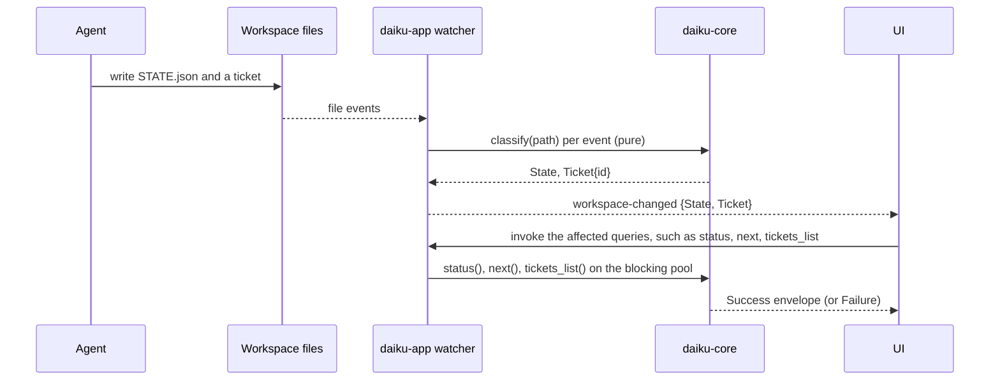

# daiku-app design

`daiku-app` is a desktop app over a daiku workspace. This page is its technical
design for the first phase, a read-only viewer: the UI stack, how the app is put
together, what it shows, and what it needs from `daiku-core`. Phase one's code is in
[`app/`](../../app/).

The filesystem stays the source of truth. The app is a view over files that agents
and the CLI are already changing, it keeps no workspace state of its own, and daiku
works the same without it.

Screens, below, gives the layout and the look of every view.

## Phases

1. **A read-only viewer** with a ticket board and live updates. This page covers
   this phase.
2. Embedded terminals running the agent CLIs people already use.
3. Editing: markdown, moving tickets and switching changes, written back through
   core.
4. Whiteboards.
5. Chat through the Agent Client Protocol, only if terminals aren't enough.

## Stack

The app is built with **Tauri 2** and a **React + TypeScript** frontend
(ADR-0007).

- **Core in-process.** Tauri's backend is Rust, so it links `daiku-core` directly,
  with no sidecar and no subprocess.
- **Later phases.** The webview reaches the components phases 2–4 need: xterm.js
  for terminals, CodeMirror for markdown, and tldraw or Excalidraw for whiteboards.
  tldraw and Excalidraw are React components, which is why the frontend is React.
- **Components.** shadcn/ui on Tailwind v4: its source is copied into the app, with
  the design system's tokens as its CSS variables (ADR-0009). The source is ours to
  style, and there is no runtime CSS-in-JS. HeroUI is out because its resizable panes
  and segmented control are paid. Ant Design is out because of its strong dashboard
  look and styles generated at runtime.
- **Packaging.** Phase one ships as a local, unsigned macOS build: `npm run tauri build
  -- --bundles app` in `app/` makes `daiku.app`. The minimum is macOS 13.3, which
  Tailwind v4 needs. There is no signing, notarization, `.dmg`, updater or release.
  Other platforms are for later.

Rejected:

| Option | Why not |
|---|---|
| GPUI | Native and fast, but terminals, rich markdown editing and a whiteboard would all be built by hand. Its docs are thin, its API moves with Zed's, and its support outside macOS is younger. |
| Wails v3 | Its backend is Go, and core is Rust. (The desktop idea preferred Wails when core was Go.) |
| Iced, egui, Slint | The same gaps as GPUI, with weaker text and editor widgets. |
| Electron | A Node backend reaches core only by running `daiku --json`, and it ships its own browser engine. |
| Dioxus desktop | The same system webview as Tauri, but the UI is written in Rust, so React components can't be used directly. |

The decision is worth reopening if GPUI gains reusable terminal and editor
components, or if WebKitGTK proves unusable on Linux for phases 2–4.

## Architecture

### Where the code lives

```
app/                     the React + TypeScript frontend (Vite)
  src/frame/             title bar, workspaces rail, status bar, folding, view state
  src/build/             the Build list
  src/plan/              the Plan list, the phase strip, ideas and ADRs
  src/viewer/            markdown and tickets
  src/board/             the two boards
  src/data/              queries and live invalidation
  src/theme/             design tokens
  src/components/ui/     the shadcn/ui components
  src/lib/               the command call, the envelope types and small helpers
  src/generated/         types generated from the JSON schemas
  src-tauri/             the daiku-app crate: its own Cargo workspace and lockfile
    src/lib.rs           Tauri setup and the command list (main.rs calls it)
    src/commands.rs      the Tauri commands
    src/envelope.rs      the escaped --json envelope
    src/env.rs           the app's daiku_core::Env
    src/view_state.rs    view-state.json
    src/watch.rs         the file watcher (see Live updates)
```

The app is outside the root Cargo workspace, which has `exclude = ["app"]`
(ADR-0010). It depends on `daiku-core` by path. So the CLI's `cargo` commands, CI and
release don't build the app or its Tauri dependencies, and core's dependency allowlist
(ADR-0005) covers core and the CLI, not the app.

The app's CI is [`.github/workflows/app.yml`](../../.github/workflows/app.yml), on
macOS. It runs on pull requests and pushes to `main` that touch `app/`,
`crates/daiku-core/`, `docs/json-schema/` or the workflow. It installs the frontend,
regenerates the types and fails if they differ, typechecks, lints, tests and builds
it, then runs `cargo fmt --check`, clippy, tests and a build in `app/src-tauri`.

### How the UI gets data

The frontend invokes Tauri commands. A command that reads a workspace opens a
`daiku_core::Workspace` and calls core. The app doesn't run the `daiku` binary.

| Command | What it does |
|---|---|
| `status`, `tickets_list`, `next`, `idea_list`, `adr_list`, `artifacts` | one core call of the same name |
| `read_artifact` | lists a change's `artifacts`, matches the path shown to one of them, then reads it with `read_text` |
| `read_ticket` | the same, matching the path against `tickets_list` |
| `read_text` | core's `read_text`; the frontend doesn't call it |

The frontend reads files only through `read_artifact` and `read_ticket`, so it can
name a file only as a listing shows it. The three reading commands refuse a file over
1 MiB. Every command in the table reads only a workspace the person has opened.
`probe_workspace`, `view_state_load`, `view_state_save` and `sync_watchers` serve the
app itself (see Opening a workspace, View state and Live updates).

Each command in the table returns the `--json` envelope (see
[`--json` output](../json.md)), with every string and key escaped (see Workspace
text): a `daiku_core::json::Success<T>` built with `Success::from_outcome`, or a
`Failure`, from `daiku_core::json::failure(&err)` for a core error or built by the app
for its own kinds (see Errors). The frontend holds the results in
TanStack Query, keyed by workspace root, command and arguments.

The frontend's TypeScript types are generated from the published schemas in
[`docs/json-schema/`](../json-schema/): `npm run gen:types` writes
`app/src/generated/`, which is committed, and CI checks that it's current. Core gains
no dependency for this, and a script or a mod that reads `--json` can use the same
types.

### Threads

Core is synchronous and has no async runtime (ADR-0003). Each command runs its
core call through `tauri::async_runtime::spawn_blocking`, so a slow disk never
blocks the UI thread. `Env` holds boxed traits with no `Send` bound, so a
`Workspace` can't cross threads: each command builds its `Env` and opens its
`Workspace` inside the closure.

The app's `daiku_core::Env` uses the real clock and `$HOME`, an `Events` that ignores
events, and a `NoProcess` that refuses to run anything. A core path that would run git
or another program fails with its usual error, so the app starts no processes through
core. These implementations are the app's own, in `app/src-tauri/src/env.rs`.

### Errors

A `Failure` carries a `kind` and a message. The view that asked shows both inline and
keeps its last good data. The read runs again on the next change that affects it, or
when the window gets focus. Core's `Warning`s come back in the envelope's `warnings`
and are shown with the data. The nudge is the exception: the status bar shows
warnings, but not a failure of `next`.

Core's kinds are those of `daiku_core::json::error_kind`. The app adds its own:

| Kind | When |
|---|---|
| `NotOpen` | the workspace isn't one the person opened |
| `TooLarge` | the file is over 1 MiB |
| `NotAnArtifact`, `NotATicket` | the path isn't in the listing |
| `AmbiguousArtifact`, `AmbiguousTicket` | two listed files show as the same path |
| `Internal` | a failure that isn't a core error |

### Workspace text

Titles, names, reasons and file bodies are shown through `Text::display`'s rule
(ADR-0008), the one the CLI applies to its output, so a control character or an
invalid byte in a workspace file shows as an escape in both clients and can't act
on the view. The app applies it, in document mode, to every string and key of the
envelope; newlines and tabs stay.

### View state

The app keeps only view state, in `view-state.json` in Tauri's app config folder: the
open workspaces, up to 10 recent ones, the selected one, the tab, the focus, the
narrow window's pane and the window size. The app writes nothing under a workspace and
never caches workspace data on disk.

## What phase one shows

| View | Core call | Shows |
|---|---|---|
| Workspaces | none (view state) | the open workspaces and recent ones; open one |
| Overview | `status()` | no view of its own: the status bar shows the active change and its phase, the Plan list the open plans and their phases, the Build list the builds and their repo locks |
| Board | `tickets_list()`, `status()` | on Build, every ticket in one of the five columns below, filtered by plan change and repo; on Plan, a column per phase and a card per open plan, with its repos, gate status and last update |
| Card | a `TicketView`, `status()` | id, title, type, repo, `depends_on`; badges for drifted, published and frozen; the build's phase and status if one started |
| Ticket | a `TicketView`, `status()`, `read_ticket` | its frontmatter fields and badges, its build's phase, status and repo lock, and its body as read-only markdown |
| Change | `artifacts()`, `read_artifact` | for a plan, each phase in order with its gate status and any skip reason, the chosen phase's files and one file as markdown. A build has no view of its own: its ticket shows its phase, status and lock |
| Ideas, ADRs | `idea_list()`, `adr_list()` | each idea's id, title and status; each ADR's number, title and status; the selected one's fields and body |
| Nudge | `next()`, `tickets_list()` | the first thing waiting on the person (see The nudge) |

### Board columns

A ticket's own `status` field isn't updated when its build ships, so the column
comes from build state first. For each ticket, from every plan change and the
inbox:

| Column | Rule |
|---|---|
| Closed | the ticket's id is in `Status.closedBuilds`: its build change is closed |
| Done | an open build has the ticket's id and its `ship` gate is `complete` |
| In build | any other open build has the ticket's id |
| Ready | no build, and `status` is `ready` or `published` |
| Draft | no build, and `status` is `draft` |

The rules are checked in that order, so a ticket is in one column at most. A ticket
with no build and any other status is in none. Drifted, published and frozen are
badges on the card, not columns. The rule is a view rule, computed in the app from
`TicketView` and `Status`, not in core.

## Screens

The window is quiet, dark and dense, a calm frame around the work. This section
gives the frame, the two tabs, the nudge, how the window folds, how a workspace
opens, and the look. The values are the starting design system. Its CSS variables are
in `app/src/theme/tokens.css`.
The layout comes from the owner's wireframes and mockups, and the component kit from
a comparison of shadcn/ui, HeroUI and Ant Design. Those working files live outside
this repo.

### The frame

One frame serves both tabs. Left to right: the workspaces rail, the viewer and the
list. The terminal arrives in phase 2, between the rail and the viewer. The two share
the width and run full height. Until then the viewer takes the terminal's width.

| Part | Size | What it holds |
|---|---|---|
| Title bar | 44px | The app name, the Plan/Build switch (centred), and the focus switch: Split, Viewer, Board |
| Workspaces rail | 52px | One chip per open workspace, and a "+" to open another |
| Viewer | the remaining width | The open ticket, plan, idea or ADR |
| List | 340px, on the right | Tickets on Build; plans, ideas and ADRs on Plan |
| Pane header | 36px | The pane's name or what's open in it, and its fill-the-window button |
| Status bar | 30px | Where you are, warnings, and the nudge |

- **Focus.** The focus switch picks Split (all panes), Viewer or Board. The viewer's
  and the list's fill buttons fill this window with the viewer or the board. They don't
  open a new one.
- **No create actions.** Phase one has no "+" to create tickets, plans or ideas,
  because creating is a write (phase 3). The rail's "+" opens a workspace and is the
  exception.

### Build

The list holds tickets in four groups, in this order. Each header has a status mark.

| Group | Mark |
|---|---|
| In build | half-filled circle |
| Ready | circle |
| Draft | dashed circle |
| Done | circle with a check |

A row shows the ticket's id, title, repo and badges, and in In build its build's phase
and the repo lock if it holds it. Groups are sorted by id, except Done, which puts the
newest build first. A group longer than eight rows folds to "N more". The next ticket
is marked: its row sits on a distinct surface with a 3px amber edge on the left. The
list leaves out Closed, which isn't work. Board focus opens the full board, with all
five columns of Board columns. Tickets that couldn't be read are listed above both.

### Plan

The list holds three groups, then a heading, in this order. Each has an icon.

| Group | Icon | Holds |
|---|---|---|
| Plans | bulleted list | open plans, by name |
| Ideas | bulb | every idea, by id |
| ADRs | scale | every ADR, newest first |
| References | book | nothing yet: a heading marked "later" |

The viewer shows a phase strip over the selected plan's files. A skipped phase is
marked with its reason. Board focus lays plans out by phase, in the order of
`Status.planPhases`: one card per open plan, in its current phase.

Listing references needs a core call that doesn't exist yet. That is a follow-up.

### Where each view lives

Every view in "What phase one shows" has a place in the frame.

| View | Where it appears |
|---|---|
| Workspaces | The rail, and the launch screen when none is open |
| Overview | The status bar and the Plan list; builds and their repo locks in the Build list's In build group |
| Board | Board focus |
| Card | A row in the list, and a card on the board |
| Ticket | The viewer |
| Change | The viewer: for a plan, the phase strip; for a build, its ticket |
| Ideas, ADRs | Groups in the Plan list, and the viewer |
| Nudge | The status bar |

Closed builds aren't listed. Their tickets, named in `Status.closedBuilds`, show in the
Build board's Closed column.

### The nudge

The status bar carries the nudge: the first item of "what's next". It starts
"Next: …". For example:

> Next: N-0020 is a draft. Start its build when you're ready.

> Next: 4-daiku-app-phase-one spec is waiting for your approval

> Next: start explore for 4-daiku-app-phase-one

In a narrow window it shortens:

> Next: N-0020 · draft

With nothing in the list it reads "Nothing is waiting on you". An item that has waited
more than 24 hours shows its age, such as "· 25h" or "· 3d". Clicking the nudge opens
the item: a plan on that phase, or a ticket (a build's item opens its ticket).

Amber marks only what needs the person: the nudge; the next mark on one ticket (that
of the first ticket-to-build item) and on one plan (that of the first plan item); the
folded list rail's count for the group holding it; and draft status labels. Nothing
decorative is amber.

**What's next** is a `daiku-core` rule, `Workspace::next()` (ADR-0011). `daiku next`
prints the same list, so the app and the CLI give the same answer. Its order:

1. an `await-approval` gate in the active change;
2. the active change's next phase that hasn't started, once every earlier phase is
   approved, skipped or complete;
3. `await-approval` gates in other open changes, longest waiting first;
4. next phases not started in other open changes, longest waiting first;
5. tickets ready to build, in dependency order and then by id.

A change gives at most one item. A `draft` or `in-progress` phase, a closed change and
a finished change give none.

A ticket is ready to build when all of these hold:

- it passes ticket validation, and its id is unique and names its file, so `daiku build
  new` can find it;
- it has no build;
- its status allows it: a planned ticket is `ready` or `published`; an `N-` or `X-`
  ticket is anything but `closed`;
- its plan isn't closed;
- its repo is registered and not archived;
- every dependency is done: its build has `ship = complete`, or its ticket is `closed`.

### Narrow windows

- From 1440px: three columns, the workspaces rail, the viewer and the list. Phase 2's
  terminal makes four.
- Below 1440px: the list folds into a rail (52px) with counts. Clicking the rail opens
  the list over the viewer.
- Below 1000px: one pane, with Viewer and List tabs. A Terminal tab arrives in phase 2.

The workspaces rail, the Plan/Build switch (centred at every width) and a shortened
status bar always stay.

### Opening a workspace

- Several workspaces open in one window, one chip each in the rail.
- The rail's "+" opens the system folder picker.
- A workspace is a folder with `.daiku/settings.json`.
- On launch the app reopens every workspace that was open and selects the one last
  selected, or else the first. A folder that's no longer a workspace is dropped.
- With none open (first launch, or every one gone), a launch screen shows recent
  workspaces and "Open workspace…".
- A folder that isn't a workspace shows "This folder isn't a daiku workspace", with
  the `daiku init` command to copy. Phase one doesn't write.
- Dropping a folder on the window or the Dock icon is a nice-to-have, not built.
- Opening from the terminal (`daiku app`) is out for now.

### The look

Principles:

- Dark only for now.
- Quiet and native, not a web dashboard.
- One accent, amber, meaning "needs you".
- Blue is only for links, focus rings and, from phase 2, the terminal prompt.
- Dense, and laptop first: every screen works at 1440x900.
- Nothing the folders don't say. Every label comes from the CLI's `--json`.
- From phase 2, the terminal gets out of the way. With focus, every keystroke goes to it.

Colours:

| Role | Token | Hex | Use |
|---|---|---|---|
| Window | `surface-window` | #1a1a1c | The viewer, the board, empty space |
| Chrome | `surface-chrome` | #1d1d20 | Title bar, rails, list and status bar |
| Terminal | `surface-terminal` | #141416 | The terminal pane only (phase 2) |
| Raised | `surface-raised` | #26262a | Cards, the switch track, row hover |
| Selected | `surface-selected` | #3a3a40 | The active segment of a switch |
| Next | `surface-next` | #2b2a26 | Behind the Next row or card |
| Line | `line` | #2e2e33 | Pane borders and header hairlines |
| Ink | `ink` | #ececef | Primary text |
| Ink secondary | `ink-secondary` | #c9c9cf | Body text, list titles |
| Ink muted | `ink-muted` | #a4a4ab | Meta text, status bar text |
| Ink faint | `ink-faint` | #9a9aa2 | Group labels, counts, empty states |
| Attention | `attention` | #f0b45a | The one accent: something needs the person |
| Attention ink | `attention-ink` | #f0c27a | Attention as text, such as the nudge |
| On attention | `on-attention` | #1a1a1c | Text on an amber fill |
| Prompt | `prompt` | #7aa7ff | Links, focus rings and, from phase 2, the terminal prompt |

The design system also has tokens for group bands (`surface-band`), the active
workspace chip (`surface-workspace`), more line weights (`line-band`, `line-control`,
`line-hover`), terminal text (`ink-terminal`), the outline and fill for a card or chip
marked Next or draft (`attention-line`, `attention-surface`) and link hover
(`prompt-hover`). The app doesn't define these yet.

Type uses two families: Inter (sans) and JetBrains Mono (mono). Ids, paths and
commands are always mono.

| Style | Family | Size | Weight |
|---|---|---|---|
| Title | sans | 20px | 600 |
| Body | sans | 13px | 400 |
| Lists and secondary | sans | 12px | 400 |
| Label | sans | 11px | 500, uppercase, 0.06em |
| Id | mono | 12px | 500 |
| Terminal (phase 2) | mono | 12px | 400 |

The Id style's size and weight aren't applied yet: ids are mono and take the text
around them.

The spacing scale is 4, 8, 12, 16 and 24px. Radii are 4, 6 and 8px, 12px for the
window, and a pill. The app applies neither of the last two yet: the window's corners
are macOS's, and badges and phase dots aren't rounded by the pill radius. The app's
own surfaces have no shadows, though some shadcn/ui controls keep theirs. Icons are
lucide's outlines, at its default 2px stroke.

## What the app needs from core

| Need | In `daiku-core` |
|---|---|
| Open a workspace | `Workspace::open` (`workspace.rs`) |
| The active change, open plans, builds by repo | `Workspace::status()` → `changes::Status` (`changes.rs`) |
| Closed builds, and the plan phases in order | `Status.closed_builds` and `Status.plan_phases` (`closedBuilds`, `planPhases` in JSON) |
| Every ticket's fields and body | `Workspace::tickets_list()` → `TicketList` of `TicketView` (`tickets.rs`) |
| What's waiting on the person | `Workspace::next()` → `NextList` (`next.rs`) |
| A change's files by phase, with its gates and skip reasons | `Workspace::artifacts()` → `ArtifactList` (`artifacts.rs`) |
| One file's text | `Workspace::read_text()` (`artifacts.rs`) |
| Ideas | `Workspace::idea_list()` (`room.rs`) |
| ADRs | `Workspace::adr_list()` (`room.rs`) |
| The envelope and errors | `json::Success`, `json::failure`, `json::error_kind` (`json.rs`) |
| What to watch | `Workspace::watch_paths()` (`watch.rs`) |
| What a file event means | `classify()` → `Changed` (`watch.rs`) |

Phase one needs no core events. `daiku_core::Event` reports progress from
operations such as `repo doctor --clone`, and what changed on disk comes from the
watcher. The paths are under `crates/daiku-core/src/`.

## Live updates

The watcher lives in the app, never in core or the CLI. Core stays free of watcher
and async crates, and gives the app two functions instead: `watch_paths` says what
to watch, and `classify` says what an event means.

1. The frontend passes the open workspaces to `sync_watchers`, which keeps one watcher
   (the `notify` crate, debounced) for each. A watcher covers `watch_paths()`, and the
   ADR folder when the settings put it elsewhere.
2. An agent or the CLI changes files. For example, gating a build rewrites
   `STATE.json` and `LOG.md`. The watcher collects events until 150 ms pass with
   none, maps each path through `classify`, and drops `None`.
3. The app emits one `workspace-changed` event to the UI with the workspace's root and
   the set of `Changed` values. The UI re-queries only what they affect:

   | `Changed` | Queries refreshed |
   |---|---|
   | `State` | `status`, `next`, `tickets_list`, `artifacts` |
   | `Ticket` | `status`, `tickets_list`, `next`, `read_ticket`; `artifacts` and `read_artifact` for the ticket's build and plan |
   | `PlanArtifact` | `status`, `tickets_list`, `next`, `read_ticket`; `artifacts` and `read_artifact` for that plan (an intake's number matches the plan named `<n>-…`) |
   | `BuildArtifact` | `artifacts` and `read_artifact` for that build |
   | `Idea` | `idea_list` |
   | `Adr` | `adr_list` |
   | `Repos` | `status`, `next` |
   | `Settings` | `status`, `adr_list` |
   | `Reference`, `Scaffold` | none |

4. The event asks for every query of the workspace to be refreshed instead when the
   watcher starts, registers or loses a watched folder, reports an error or lost
   events, sees the root, `plan`, `plan/specs`, `build` or `build/tickets` created,
   removed or renamed, or sees a path it can't place under the root.
5. Bringing the window to the front also refetches the queries on screen.
6. Core writes files in place, so a read can see a half-written file. A read that
   fails keeps the view's last data, shows the error, and runs again on the next
   change that affects it, or on focus.



## Interfaces

These are the core additions made for the app. All of them add no dependency, print
nothing and stay synchronous.

### `watch_paths` and `classify`

```rust
// crates/daiku-core/src/watch.rs, re-exported from the crate root.
pub struct WatchPath { pub path: PathBuf, pub recursive: bool }

impl Workspace {
    /// What a client watches: the root non-recursively (STATE.json, REPOS.json,
    /// LOG.md, AGENTS.md), and `.daiku`, `plan`, `build`, `ideas` and
    /// `references` recursively. A missing folder is still listed, so the client
    /// can watch for it. No I/O.
    pub fn watch_paths(&self) -> Vec<WatchPath>;
}

#[derive(Debug, Clone, PartialEq, Eq, Hash, Serialize, JsonSchema)]
#[serde(tag = "kind", rename_all = "camelCase")]
#[non_exhaustive]
pub enum Changed {
    State,                                          // STATE.json, .daiku/active, LOG.md
    Ticket { id: String, change: Option<String> },  // plan/specs/<c>/tickets/<id>.md, build/tickets/<id>.md
    PlanArtifact { change: String },                // other files under plan/specs/<c>/, plan/<room>/<c>/…,
                                                    // and plan/00_intake/<n>.md (see below)
    BuildArtifact { repo: String, change: String }, // build/<repo>/changes/<c>/…
    Idea { id: i64 },                               // ideas/<n>-<slug>/…
    Adr,                                            // plan/04_architecture/adr/…
    Repos,                                          // REPOS.json, .daiku/paths.json
    Settings,                                       // .daiku/settings.json
    Reference,                                      // references/…
    Scaffold,                                       // AGENTS.md, room context, persona and template files
}

/// What a change at `rel` (relative to the root, either separator) means.
/// No I/O. `None` for paths daiku doesn't read (`.git`, `.DS_Store`, editor
/// swap files).
pub fn classify(rel: &Path) -> Option<Changed>;
```

`classify` depends on the path alone, so it's cheap to call on every event and
can be tested with a table of paths. A plan change's files live in more than one
room: its spec, architecture and tickets under `plan/specs/<change>/`, its explore
notes under `plan/02_explore/<change>/`, and its intake at `plan/00_intake/<n>.md`.
All of them are `PlanArtifact`, except tickets, which are `Ticket`. An intake's path
has only the change's number, so `classify` returns that number as `change`, and
the client matches it to the plan change whose name starts with `<n>-`. Room files
that belong to no change (`context.md`, `personas/`, `templates/`) are `Scaffold`.

### `tickets_list` and `TicketView`

```rust
// crates/daiku-core/src/tickets.rs
#[derive(Debug, Clone, PartialEq, Eq, Serialize, JsonSchema)]
#[serde(rename_all = "camelCase")]
pub struct TicketView {
    pub id: String,
    #[serde(rename = "type")]
    pub typ: String,
    pub title: String,
    pub repo: String,
    pub change: String, // "" for an inbox ticket
    pub change_closed: bool, // `changeClosed` in JSON: the ticket's plan is closed
    pub inbox: bool,
    pub path: String,
    pub status: String,
    pub depends_on: Vec<String>,
    pub parent: String,
    pub requirements: Vec<String>,
    pub labels: Vec<String>,
    pub external: BTreeMap<String, String>,
    pub drifted: bool,
    pub frozen: bool,
    pub body: crate::text::Text, // keeps non-UTF-8 bytes, as idea summaries do
}

#[derive(Debug, Clone, PartialEq, Eq, Serialize, JsonSchema)]
#[serde(rename_all = "camelCase")]
pub struct TicketList {
    pub tickets: Vec<TicketView>,
    pub unreadable: Vec<Problem>,
}

impl Workspace {
    /// Every plan change's tickets and the inbox's, sorted by id then path, and
    /// the files that couldn't be read.
    pub fn tickets_list(&self) -> Result<Outcome<TicketList>, Error>;
}
```

`daiku tickets list` prints the same list, with `--json` or as one
`id  status  repo  title` line per ticket.

### `next`

```rust
// crates/daiku-core/src/next.rs
#[derive(Debug, Clone, PartialEq, Eq, Serialize, JsonSchema)]
#[serde(tag = "kind", rename_all = "camelCase")]
#[non_exhaustive]
pub enum NextItem {
    /// A gate at await-approval.
    Approve { change: String, r#loop: String, phase: String, active: bool, since: Option<String> },
    /// The change's next phase hasn't started.
    Start { change: String, r#loop: String, phase: String, active: bool, since: Option<String> },
    /// A ticket ready to build.
    Build { ticket: String, title: Text, repo: String, change: String, since: Option<String> },
}

#[derive(Debug, Clone, PartialEq, Eq, Serialize, JsonSchema)]
#[serde(rename_all = "camelCase")]
pub struct NextList { pub items: Vec<NextItem> }

impl Workspace {
    /// What is waiting on the person, first to last (see The nudge). It writes
    /// nothing and reads no clock; a bad ticket file or registry is a warning.
    pub fn next(&self) -> Result<Outcome<NextList>, Error>;
}
```

`since` is a change's `updatedAt`. For a ticket it's the latest `updatedAt` of its
dependencies' builds, else its plan's, else none. `daiku next` prints the list, with
`--json` or as one line per item.

### `artifacts` and `read_text`

```rust
// crates/daiku-core/src/artifacts.rs
#[derive(Debug, Clone, PartialEq, Eq, Serialize, JsonSchema)]
#[serde(rename_all = "camelCase")]
pub struct Artifact { pub phase: String, pub path: String } // relative to the root, '/'

#[derive(Debug, Clone, PartialEq, Eq, Serialize, JsonSchema)]
#[serde(rename_all = "camelCase")]
pub struct ArtifactList {
    pub change: Change,
    pub phases: Vec<String>,      // the machine's phase names, in order
    pub artifacts: Vec<Artifact>, // existing files only, in phase order then path
}

impl Workspace {
    /// A change's files by phase. An unknown change is `UnknownChange`.
    pub fn artifacts(&self, change: &str) -> Result<Outcome<ArtifactList>, Error>;
    /// The bytes of the workspace file `rel`. A path that is empty, absolute or has
    /// a `.` or `..` segment is `ReadOutside`; a symlink below the root is
    /// `ReadThroughSymlink`; a missing or unreadable file is `CannotRead`.
    pub fn read_text(&self, rel: &str) -> Result<Text, Error>;
}
```

`daiku artifacts <change>` prints the list, with `--json` or as `phase  path` lines.
`read_text` has no CLI form: its equivalent is the file.

## A Herdr mod

[Herdr](https://herdr.dev/app)'s desktop app runs JavaScript mods that can run
commands and watch folders. A daiku mod could read `daiku … --json` and use
`watchFolder` for live updates, sharing the TypeScript types generated from
`docs/json-schema/`. It would be a separate client from `daiku-app`, and it isn't
designed here.

## Later phases

Choices here that later phases rely on:

- Writes (phase 3) go through core, never straight to files from the frontend.
- Terminals (phase 2) use xterm.js with a PTY, or herdr-core.
- Whiteboard files (phase 4) live in the workspace, so agents can read them.

Open questions, left for those phases:

- herdr-core or a PTY the app owns, behind an adapter.
- The whiteboard file format (Excalidraw or tldraw JSON) and its folder.
- Whether starting an agent from a ticket creates a git worktree per ticket, and
  how that works across repos in `REPOS.json`.
- How early to test WebKitGTK on Linux for xterm.js and canvas performance.
- Whether core should write files atomically, so a watcher never sees half a file.
