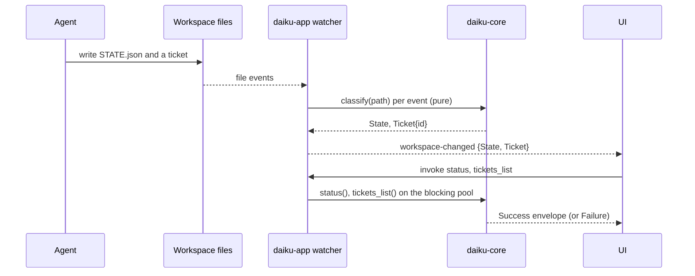

# daiku-app design

`daiku-app` is a desktop app over a daiku workspace. This page is its technical
design for the first phase, a read-only viewer: the UI stack, how the app is put
together, what it shows, and what it needs from `daiku-core`. No app code exists
yet.

The filesystem stays the source of truth. The app is a view over files that agents
and the CLI are already changing, it keeps no workspace state of its own, and daiku
works the same without it.

Screen layout and visual design aren't covered here. This page defines what each
view shows, not how it looks.

## Phases

1. **A read-only viewer** with a ticket board and live updates. This page covers
   this phase.
2. Editing: markdown, moving tickets and switching changes, written back through
   core.
3. Embedded terminals running the agent CLIs people already use.
4. Whiteboards.
5. Chat through the Agent Client Protocol, only if terminals aren't enough.

## Stack

The app is built with **Tauri 2** and a **React + TypeScript** frontend
(ADR-0007).

- **Core in-process.** Tauri's backend is Rust, so it links `daiku-core` directly,
  with no sidecar and no subprocess.
- **Later phases.** The webview reaches the components phases 2–4 need: xterm.js
  for terminals, CodeMirror for markdown, and tldraw or Excalidraw for whiteboards.
  tldraw and Excalidraw are React components, which is why the frontend is React.
- **Packaging.** Tauri bundles for macOS, Windows and Linux.

Rejected:

| Option | Why not |
|---|---|
| GPUI | Native and fast, but terminals, rich markdown editing and a whiteboard would all be built by hand. Its docs are thin, its API moves with Zed's, and its support outside macOS is younger. |
| Wails v3 | Its backend is Go, and core is Rust. (The desktop idea preferred Wails when core was Go.) |
| Iced, egui, Slint | The same gaps as GPUI, with weaker text and editor widgets. |
| Electron | A Node backend reaches core only by running `daiku --json`, and it ships its own browser engine. |
| Dioxus desktop | The same system webview as Tauri, but the UI is written in Rust, so React components can't be used directly. |

The decision is worth reopening if GPUI gains reusable terminal and editor
components, or if WebKitGTK proves unusable on Linux for phases 3–4.

## Architecture

### Where the code lives

```
crates/daiku-app/        Cargo workspace member, not in default-members
  src/main.rs            Tauri setup: registers the commands, owns the watcher
  src/commands.rs        one Tauri command per read
  src/watch.rs           the file watcher (see Live updates)
  ui/                    the React + TypeScript frontend (Vite)
```

`daiku-app` is a member of the Cargo workspace but not of `default-members`. So
`cargo test` and the release keep building only core, the CLI and the fixture
runner, and Tauri's dependencies (WebKitGTK on Linux) stay off their CI jobs. The
app gets its own CI job when it's built. Core's dependency allowlist (ADR-0005)
covers core and the CLI, not the app.

### How the UI gets data

Each Tauri command opens a `daiku_core::Workspace` and calls one core function.
It returns what `--json` would print: a `daiku_core::json::Success<T>` built with
`Success::from_outcome`, or `daiku_core::json::failure(&err)` (see
[`--json` output](../json.md)). The app doesn't run the `daiku` binary.

The frontend's TypeScript types are generated from the published schemas in
[`docs/json-schema/`](../json-schema/) as part of the app's build, for example with
`json-schema-to-typescript`. Core gains no dependency for this, and a script or a
mod that reads `--json` can use the same types.

### Threads

Core is synchronous and has no async runtime (ADR-0003). Each command runs its
core call through `tauri::async_runtime::spawn_blocking`, so a slow disk never
blocks the UI thread. `Env` holds boxed traits with no `Send` bound, so a
`Workspace` can't cross threads: each command builds its `Env` and opens its
`Workspace` inside the closure.

The app's `daiku_core::Env` uses the real clock and process runner and an `Events`
that ignores events: phase one runs no git and no clone. Those implementations
(`SystemClock`, `ChildProcess`, `NoEvents`) live in the CLI binary, in
`crates/daiku-cli/src/env.rs`, which the app can't depend on, so the app carries its
own copies. Whether to share them instead is left to the app's build ticket.

### Errors

A `Failure` carries a `kind` and a message (`daiku_core::json::error_kind`). The
view that asked shows it inline and keeps its last good data. Core's `Warning`s
come back in the envelope's `warnings` and are shown with the data.

### Workspace text

Titles, names, reasons and file bodies are shown through `Text::display`
(ADR-0008), the rule the CLI applies to its output, so a control character or an
invalid byte in a workspace file shows as an escape in both clients and can't act
on the view.

### View state

The app keeps only view state: recent workspaces, the last workspace and view
opened, and window size. It's stored in Tauri's app config folder. The app writes
nothing under a workspace and never caches workspace data on disk.

## What phase one shows

| View | Core call | Shows |
|---|---|---|
| Workspaces | none (view state) | recent workspace roots; open one |
| Overview | `Workspace::status()` | the active change; open plans with phase, status and gates; builds by repo, with the build holding each repo's lock |
| Board | `Workspace::tickets_list()` and `status()` | every ticket in one of the five columns below; filter by plan change and repo |
| Card | a `TicketView` | id, title, type, repo, `depends_on`; badges for drifted, published and frozen; the build's phase and status if one started |
| Ticket | a `TicketView` | its frontmatter fields, and its body as read-only markdown |
| Change | `status()`, and `status_plan(name)` for a plan | each phase in `Change::machine()` order with its gate and any skip reason; for a plan, its `BuildRow`s |
| Ideas, ADRs | `Workspace::idea_list()`, `adr_list()` | each idea's id, title and status; each ADR's number, title and status |

### Board columns

A ticket's own `status` field isn't updated when its build ships, so the column
comes from build state first. For each ticket, from every plan change and the
inbox:

| Column | Rule |
|---|---|
| Closed | a build change with the ticket's id exists and is closed |
| Done | a build exists and its `ship` gate is `complete` |
| In build | a build exists, and neither of the above applies |
| Ready | no build, and `status` is `ready` or `published` |
| Draft | no build, and `status` is `draft` |

The rules are checked in that order, so every ticket lands in exactly one column.
Drifted, published and frozen are badges on the card, not columns. The rule is a
view rule, computed in the app from `TicketView` and `Status`, not in core.

## What the app needs from core

| Need | In `daiku-core` |
|---|---|
| Open a workspace | `Workspace::open` (`workspace.rs`) |
| The active change, open plans, builds by repo | `Workspace::status()` → `changes::Status` (`changes.rs`) |
| A plan and its builds | `Workspace::status_plan()` → `changes::PlanStatus`, `plan::overview::BuildRow` |
| A change's phases and gates | `state::Change`, `Change::machine()` (`state/mod.rs`) |
| Ideas | `Workspace::idea_list()` (`room.rs`) |
| ADRs | `Workspace::adr_list()` (`room.rs`) |
| The envelope and errors | `json::Success`, `json::failure`, `json::error_kind` (`json.rs`) |
| Every ticket's fields and body | **missing:** `Workspace::tickets_list()` and `TicketView`, in N-0013 |
| What to watch | **missing:** `Workspace::watch_paths()`, in N-0012 |
| What a file event means | **missing:** `classify()` and `Changed`, in N-0012 |

Phase one needs no core events. `daiku_core::Event` reports progress from
operations such as `repo doctor --clone`, and what changed on disk comes from the
watcher. The paths are under `crates/daiku-core/src/`.

## Live updates

The watcher lives in the app, never in core or the CLI. Core stays free of watcher
and async crates, and gives the app two functions instead: `watch_paths` says what
to watch, and `classify` says what an event means.

1. When a workspace opens, the app shows the Overview and Board, and starts a
   watcher (the `notify` crate) on `watch_paths()`.
2. An agent or the CLI changes files. For example, gating a build rewrites
   `STATE.json` and `LOG.md`. The watcher collects events until 150 ms pass with
   none, maps each path through `classify`, and drops `None`.
3. The app emits one `workspace-changed` event to the UI with the set of `Changed`
   values. The UI re-queries only the views they affect:
   - `State` → Overview, Board, Change;
   - `Ticket` → Board, and that ticket if it's open;
   - `Idea` → Ideas;
   - `Adr` → ADRs;
   - `Repos` or `Settings` → Overview.
   - the rest (`PlanArtifact`, `BuildArtifact`, `Reference`, `Scaffold`) refresh no
     phase-one view, and are there for later phases.
4. Core writes files in place, so a read can see a half-written file. A read that
   fails keeps the view's last data, shows the error, and is retried on the next
   event.



## Interfaces

These are the core additions the app needs. They're the target for N-0012 and
N-0013, not code that exists yet. All of them add no dependency, print nothing
and stay synchronous.

### `watch_paths` and `classify` (N-0012)

```rust
// crates/daiku-core/src/watch.rs, re-exported from the crate root.
pub struct WatchPath { pub path: PathBuf, pub recursive: bool }

impl Workspace {
    /// What a client watches: the root non-recursively (STATE.json, REPOS.json,
    /// LOG.md, AGENTS.md), and `.daiku`, `plan`, `build`, `ideas` and
    /// `references` recursively. A missing folder is still listed, so the client
    /// can watch for it. No I/O.
    pub fn watch_paths(&self) -> Vec<WatchPath>;
}

#[derive(Debug, Clone, PartialEq, Eq, Hash, Serialize, JsonSchema)]
#[serde(tag = "kind", rename_all = "camelCase")]
#[non_exhaustive]
pub enum Changed {
    State,                                          // STATE.json, .daiku/active, LOG.md
    Ticket { id: String, change: Option<String> },  // plan/specs/<c>/tickets/<id>.md, build/tickets/<id>.md
    PlanArtifact { change: String },                // other files under plan/specs/<c>/, plan/<room>/<c>/…,
                                                    // and plan/00_intake/<n>.md (see below)
    BuildArtifact { repo: String, change: String }, // build/<repo>/changes/<c>/…
    Idea { id: i64 },                               // ideas/<n>-<slug>/…
    Adr,                                            // plan/04_architecture/adr/…
    Repos,                                          // REPOS.json, .daiku/paths.json
    Settings,                                       // .daiku/settings.json
    Reference,                                      // references/…
    Scaffold,                                       // AGENTS.md, room context, persona and template files
}

/// What a change at `rel` (relative to the root, either separator) means.
/// No I/O. `None` for paths daiku doesn't read (`.git`, `.DS_Store`, editor
/// swap files).
pub fn classify(rel: &Path) -> Option<Changed>;
```

`classify` depends on the path alone, so it's cheap to call on every event and
can be tested with a table of paths. A plan change's files live in more than one
room: its spec, architecture and tickets under `plan/specs/<change>/`, its explore
notes under `plan/02_explore/<change>/`, and its intake at `plan/00_intake/<n>.md`.
All of them are `PlanArtifact`, except tickets, which are `Ticket`. An intake's path
has only the change's number, so `classify` returns that number as `change`, and
the client matches it to the plan change whose name starts with `<n>-`. Room files
that belong to no change (`context.md`, `personas/`, `templates/`) are `Scaffold`.

### `tickets_list` and `TicketView` (N-0013)

```rust
// crates/daiku-core/src/tickets.rs
#[derive(Debug, Clone, PartialEq, Eq, Serialize, JsonSchema)]
#[serde(rename_all = "camelCase")]
pub struct TicketView {
    pub id: String,
    #[serde(rename = "type")]
    pub typ: String,
    pub title: String,
    pub repo: String,
    pub change: String, // "" for an inbox ticket
    pub inbox: bool,
    pub path: String,
    pub status: String,
    pub depends_on: Vec<String>,
    pub parent: String,
    pub requirements: Vec<String>,
    pub labels: Vec<String>,
    pub external: BTreeMap<String, String>,
    pub drifted: bool,
    pub frozen: bool,
    pub body: crate::text::Text, // keeps non-UTF-8 bytes, as idea summaries do
}

#[derive(Debug, Clone, PartialEq, Eq, Serialize, JsonSchema)]
#[serde(rename_all = "camelCase")]
pub struct TicketList {
    pub tickets: Vec<TicketView>,
    pub unreadable: Vec<Problem>,
}

impl Workspace {
    /// Every plan change's tickets and the inbox's, sorted by id, and the files
    /// that couldn't be read, as `tickets status` reports them.
    pub fn tickets_list(&self) -> Result<Outcome<TicketList>, Error>;
}
```

Whether the CLI also gains `daiku tickets list --json` is decided in N-0013.

## A Herdr mod

[Herdr](https://herdr.dev/app)'s desktop app runs JavaScript mods that can run
commands and watch folders. A daiku mod could read `daiku … --json` and use
`watchFolder` for live updates, sharing the TypeScript types generated from
`docs/json-schema/`. It would be a separate client from `daiku-app`, and it isn't
designed here.

## Later phases

Choices here that later phases rely on:

- Writes (phase 2) go through core, never straight to files from the frontend.
- Terminals (phase 3) use xterm.js with a PTY, or herdr-core.
- Whiteboard files (phase 4) live in the workspace, so agents can read them.

Open questions, left for those phases:

- herdr-core or a PTY the app owns, behind an adapter.
- The whiteboard file format (Excalidraw or tldraw JSON) and its folder.
- Whether starting an agent from a ticket creates a git worktree per ticket, and
  how that works across repos in `REPOS.json`.
- How early to test WebKitGTK on Linux for xterm.js and canvas performance.
- Whether core should write files atomically, so a watcher never sees half a file.
