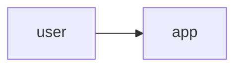
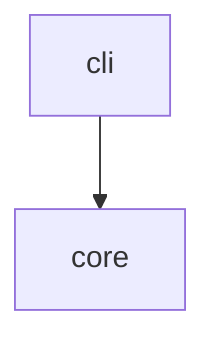
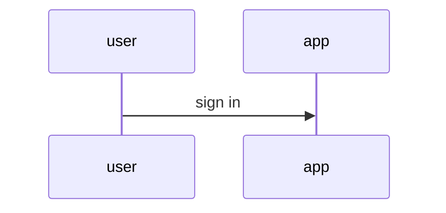
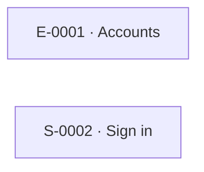

# 1-auth-flow

<!-- daiku:narrative -->
<!-- About 250 words: the problem, the shape of the solution, who's affected, and what's out of scope. -->
<!-- /daiku:narrative -->

<!-- daiku:generated — do not edit; run `daiku overview` -->

## Status

| Phase | Status | Note |
|---|---|---|
| intake | approved |  |
| research | skipped | known domain |
| explore | skipped | no repo in the intake |
| synthesis | skipped | fewer than two repos in scope |
| spec | approved |  |
| architecture | approved |  |
| breakdown | approved |  |
| publish | complete |  |

## Diagrams

### Context

### Layers

### Flow: sign in

From [architecture.md](architecture.md).

## Work map

- [**E-0001**](tickets/E-0001.md) Accounts · published · github org/api#11
  - [**S-0002**](tickets/S-0002.md) Sign in · `api` · published · github org/api#12 · R1

## Dependencies

### E-0001 · Accounts

## Repos

| Repo | draft | ready | published | Tickets |
|---|---|---|---|---|
| `api` | 0 | 0 | 1 | [S-0002](tickets/S-0002.md) |

## Builds

| Ticket | Repo | Build |
|---|---|---|
| [S-0002](tickets/S-0002.md) | `api` | ticket approved |

## Decisions

_None yet._

## Traceability

From [functional-spec.md](functional-spec.md).

| Req | Priority | Covered by |
|---|---|---|
| R1 | must | [S-0002](tickets/S-0002.md) |

## Problems

- ! README: narrative is empty

<!-- /daiku:generated -->
