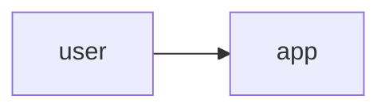
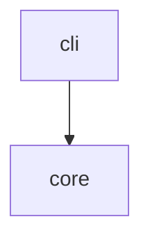
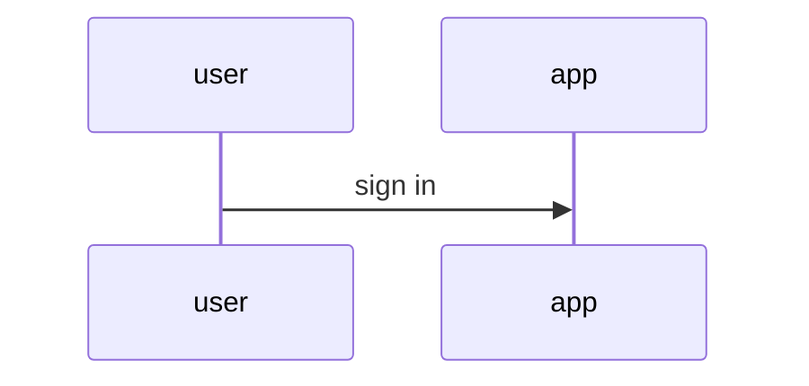
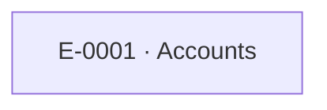

# 1-auth-flow

<!-- daiku:narrative -->
<!-- About 250 words: the problem, the shape of the solution, who's affected, and what's out of scope. -->
<!-- /daiku:narrative -->

<!-- daiku:generated — do not edit; run `daiku overview` -->

## Status

| Phase | Status | Note |
|---|---|---|
| intake | approved |  |
| research | skipped | known domain |
| explore | skipped | no repo in the intake |
| synthesis | skipped | fewer than two repos in scope |
| spec | — |  |
| architecture | — |  |
| breakdown | — |  |
| publish | — |  |

## Diagrams

### Context

### Layers

### Flow: sign in

From [architecture.md](architecture.md).

## Work map

- [**E-0001**](tickets/E-0001.md) Accounts · draft

## Dependencies

### E-0001 · Accounts

## Repos

_None yet._

## Builds

_None yet._

## Decisions

_None yet._

## Traceability

From [functional-spec.md](functional-spec.md).

| Req | Priority | Covered by |
|---|---|---|
| R1 | must | **uncovered** |

## Problems

- ! R1: must requirement in 1-auth-flow isn't cited by any ticket

<!-- /daiku:generated -->
